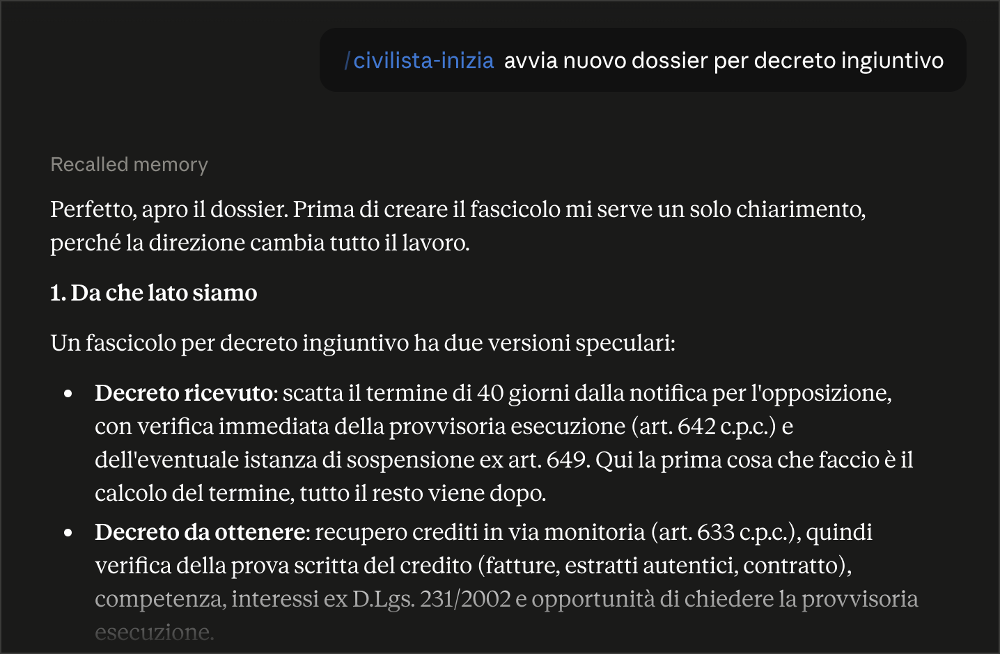
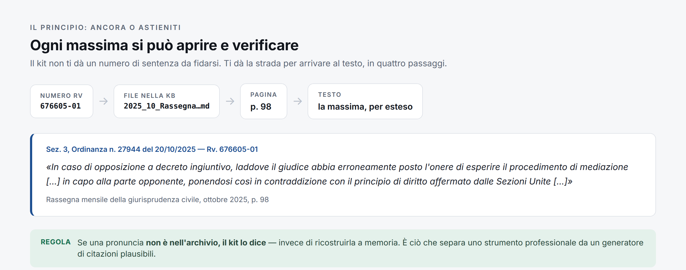

[](https://github.com/Synthos-Logic/civilista-italia/releases)
[](LICENSE)
[](https://github.com/Synthos-Logic/giurisprudenza-db)
[](docs/INSTALLAZIONE.md)

# Kit Civilista Italiano

**Assistente operativo per avvocati civilisti italiani, con giurisprudenza ancorata e verificabile.**
Kit gemello del [Kit Penalista Italiano](https://github.com/Synthos-Logic/penalista-italia), da cui eredita l'impianto anti-allucinazione.

**➜ [Pagina di presentazione del progetto](https://synthos-logic.github.io/civilista-italia/)** — se questa pagina ti sembra troppo tecnica, comincia da lì.
**➜ [Come si lavora col kit](docs/METODO.md)** — il metodo: dove vivono i fascicoli, come si apre e si chiude una sessione, come fargli seguire la tua impostazione negli atti.

Il kit copre per prime le materie che pesano davvero nella pratica quotidiana di uno studio civile: **decreto ingiuntivo e opposizione**, **diritto del lavoro**, **diritto di famiglia**. Poi contratti, responsabilità civile, locazioni e condominio.

**Non serve saper programmare, non c'è nulla da acquistare, non serve un account GitHub.** Serve l'app Claude sul computer. L'installazione è più sotto: dieci minuti.

---

## Come funziona, su un caso vero

Un cliente arriva in studio con un decreto ingiuntivo notificato ieri. Apri una conversazione e scrivi, a parole tue:

> *«Un cliente ha ricevuto un decreto ingiuntivo per 38.000 euro, notificato il 3 settembre. Da dove partiamo?»*

Non devi scegliere un comando: la frase attiva da sola `civilista-monitorio`. Quello che succede dopo, in sintesi.



*La prima cosa che chiede è la direzione, perché cambia tutto il lavoro che segue. Poi:*

**1. Prima le tre date, non la strategia.** Il kit chiede data di notifica, data di pronuncia e termine scritto nel decreto, e verifica se il decreto è **provvisoriamente esecutivo ex art. 642** — perché in quel caso il cliente può essere pignorato *durante* l'opposizione, e questo cambia l'ordine delle cose da fare. Poi calcola i **40 giorni** dell'art. 641 con il ragionamento in chiaro, sospensione feriale inclusa, e li scrive nello scadenziario del fascicolo con due allarmi: a metà termine e a sette giorni dalla scadenza.

**2. Ti mette in guardia da un errore che chiude la causa.** Questo lo dice sempre, in tre punti diversi, perché è l'errore più costoso della materia:

> **Depositare una domanda di mediazione non ferma i quaranta giorni.** L'art. 8 D.Lgs. 28/2010 le attribuisce gli effetti della domanda giudiziale sulla prescrizione, non sui termini di decadenza. Chi tratta invece di opporre si ritrova con un titolo esecutivo definitivo.

**3. Ti dice su chi grava l'onere della mediazione — e lo dimostra.** Nell'opposizione l'onere di attivare la mediazione è del **ricorrente monitorio**, non dell'opponente (art. 5-bis D.Lgs. 28/2010, dopo Sezioni Unite n. 19596 del 2020). Il kit non si limita ad affermarlo: apre la Knowledge Base e ti mostra la massima, con numero, fonte e pagina, così la puoi verificare prima di metterla in un atto.

> **Rv. 676605-01** — Sez. 3, Ordinanza n. 27944 del 20/10/2025
> *«In caso di opposizione a decreto ingiuntivo, laddove il giudice abbia erroneamente posto l'onere di esperire il procedimento di mediazione […] in capo alla parte opponente, ponendosi così in contraddizione con il principio di diritto affermato dalle Sezioni Unite nella sentenza n. 19596 del 2020, il successivo rilievo del mancato esperimento della stessa si risolve nel mancato esercizio del potere di rilevazione del difetto di mediazione […] con la conseguenza della sanatoria del difetto di procedibilità del giudizio.»*
> — *Rassegna mensile della giurisprudenza civile, ottobre 2025*, p. 98

**4. Poi la partita dei primi trenta giorni.** Presupposti e tempi dell'**istanza ex art. 649** (sospensione della provvisoria esecuzione: fumus *e* periculum, entrambi documentati) e della difesa **contro l'istanza ex art. 648**, contestata voce per voce. È lì che si decide chi tiene il coltello dalla parte del manico mentre la causa va avanti.

**5. E la domanda che nessuno fa al cliente abbastanza presto.** *Conviene opporsi?* Se il credito è dovuto e la difesa pretestuosa, l'opposizione aggiunge spese e interessi: il kit calcola il conto reale — capitale, interessi, rivalutazione, nota spese, rischio di soccombenza — e prepara il **parere scritto al cliente** con costi, tempi e alternative, piano di rientro incluso.

Il tutto sta dentro una **check-list dei primi sette giorni**, un giorno per volta, che finisce nel fascicolo insieme allo scadenziario.

**Lo stesso schema vale per le altre materie**: nel lavoro le due fasi dell'impugnazione del licenziamento (60 giorni + 180, dove il secondo decorre dall'impugnazione e non dal licenziamento) e il promemoria che **le cause di lavoro non si sospendono ad agosto**; in famiglia la scelta della strada prima della tecnica, e il rito 473-bis con l'obbligo di deposito della documentazione economica.

---

## Le skill

| Skill | A cosa serve |
|---|---|
| `civilista-inizia` | Avvio guidato: dal primo messaggio al primo fascicolo operativo, su un caso vero |
| `civilista-caso` | Analisi e strategia: onere della prova, preclusioni, procedibilità, punti deboli, convenienza economica |
| `civilista-scadenze` | Termini civili con ragionamento esplicito — inclusi i termini **a ritroso**, dove la scadenza di sabato si anticipa invece di prorogarsi |
| `civilista-giurisprudenza` | Ricerca in KB con citazioni verificabili e copertura dichiarata |
| `civilista-verifica` | Controllo pre-deposito a 10 punti: citazioni, termini, decadenze, procedibilità, forma dell'atto |
| `civilista-atti` | Redazione degli atti: citazione, comparsa, memorie 171-ter, monitorio e opposizione, appello, cassazione, precetto, diffida |
| `civilista-monitorio` | Decreto ingiuntivo end-to-end: quando conviene, provvisoria esecuzione, opposizione, istanze ex artt. 648 e 649, check-list dei primi sette giorni |
| `civilista-lavoro` | Licenziamenti (60 giorni + 180), crediti retributivi, mansioni, rito lavoro — che **non si sospende ad agosto** |
| `civilista-famiglia` | Separazione e divorzio, affidamento e mantenimento, rito 473-bis, negoziazione assistita, ordini di protezione |
| `civilista-adr` | Condizione di procedibilità: mediazione o negoziazione, effetti su prescrizione e decadenza, conduzione |
| `civilista-quantificazione` | Quanto si chiede e quanto costa: danno, interessi e rivalutazione, nota spese, rischio economico |
| `civilista-archivio` | Conversione e indicizzazione di nuove fonti nella KB |

**Dodici schede di materia** in `KNOWLEDGE_BASE/06_SCHEDE_MATERIA/` (inadempimento, recupero crediti, opposizione a decreto ingiuntivo, responsabilità extracontrattuale e sanitaria, danno da circolazione, locazioni e sfratti, condominio, separazione e divorzio, mantenimento e affidamento, licenziamento, crediti di lavoro): fatti costitutivi e onere della prova, termini, condizione di procedibilità, rito e competenza, difese dai due lati, quantificazione, errori ricorrenti. Senza numeri di sentenza — quelli si prendono dalla KB.

---

## Cosa c'è già, e perché conta

**10.080 massime civili indicizzate e citabili con riscontro testuale**, dal 2023 a **febbraio 2026**. Due fonti ufficiali e pubbliche dell'Ufficio del Massimario:

| Fonte | Periodo | Massime |
|---|---|---|
| *Rassegne annuali — Gli orientamenti delle Sezioni Civili* (3 volumi per anno) | 2023 e 2024 | 6.122 |
| *Rassegne mensili della giurisprudenza civile* | gennaio 2025 → febbraio 2026 | 3.958 |

A queste si aggiunge, **ogni lunedì e senza che tu debba fare nulla**, il flusso della pipeline pubblica: pronunce civili segnalate dall'Ufficio del Massimario, rinvii pregiudiziali ex art. 363-bis, nuove rassegne mensili convertite e indicizzate, e le segnalazioni dalle riviste civilistiche.

Le due fonti si integrano perché il Massimario lavora su tempi diversi: **la Rassegna annuale consolida l'anno e arriva con 12-18 mesi di ritardo** (quella del 2024 è uscita l'8 gennaio 2026; la 2025 non esiste ancora), mentre le mensili escono a circa 4-5 mesi. Nella KB il periodo recente è quindi coperto dalle mensili, in attesa del consolidato.

Due lacune dichiarate, per onestà: **febbraio e marzo 2025 non risultano pubblicati** sul portale della Corte, e da marzo 2026 in poi le mensili non sono ancora uscite.

Ogni massima è raggiungibile così:



**Il principio è: ancora o astieniti.** Se una massima non è nella KB, il kit dichiara *"non presente in KB"* invece di ricostruirla a memoria. È la regola che distingue uno strumento professionale da un generatore di citazioni plausibili — un problema reale, sanzionato dalla stessa Cassazione.

**Nota sui dati personali.** Le Rassegne mensili riportano, sotto ogni massima, la riga delle parti (già ridotte a iniziali dalla fonte) con il **nome del difensore**. Nei testi pubblicati questi nominativi sono sostituiti con **[omissis]** — 8.813 occorrenze, da una procedura automatica. Restano i dati istituzionali della citazione (presidente, estensore, relatore, P.M.) e resta intatto tutto il resto: massima, estremi, classificazione, ancoraggio alle pagine.

---

## Perimetro dichiarato

In ordine di quanto pesano nella pratica quotidiana:

1. **Recupero crediti e procedimento monitorio** — decreto ingiuntivo e opposizione
2. **Diritto del lavoro** — licenziamenti, crediti retributivi, rito lavoro
3. **Diritto di famiglia** — separazione, divorzio, figli, assegni
4. **Obbligazioni e contratti**
5. **Responsabilità civile e danni**
6. **Locazioni e condominio**

Due avvertenze che il kit ripete sempre all'avvocato: le **cause di lavoro non si sospendono ad agosto**, e il **Tribunale per le persone, i minorenni e le famiglie non è ancora operativo**.

**Cosa non fa, detto prima e non dopo.** Fuori perimetro: tributario, crisi d'impresa, protezione internazionale, previdenza in senso proprio, societario. Non ha la giurisprudenza di merito, perché la banca dati del Ministero è accessibile solo con SPID e non è riutilizzabile. E **ogni atto che produce è una bozza**: la revisione resta dell'avvocato.

---

## Installazione

**Dieci minuti, nessuna competenza tecnica.**


### 1. Il plugin

Nell'app Claude sul computer, barra laterale in basso a sinistra: **Personalizza**. In alto a destra il pulsante **+** → **Crea plugin** → **Aggiungi marketplace**. Nel campo che compare incolla esattamente:

```
Synthos-Logic/civilista-italia
```

Non è un indirizzo web: è il nome del repository, con il trattino. Clicca **Sincronizza**.

Si apre la Directory: scegli **Plugin**, poi la scheda **Personale**. Compare la scheda **Civilista Italia**: clicca il **+**. Dopo qualche secondo leggi *«Civilista italia è installato e pronto all'uso»*.

Dai **tre puntini (···)** accanto al nome puoi attivare **"Sincronizza automaticamente"**, così gli aggiornamenti arrivano da soli.

Verifica in una **conversazione nuova**: `/civilista-italia:versione` deve rispondere con la versione e l'elenco delle skill.

### 2. La cartella di lavoro

Il plugin è il motore; la cartella è l'archivio. Servono entrambi.

Qui sopra, pulsante verde **Code** → **Download ZIP**. Decomprimi, rinomina la cartella in **`Civile-Italia`**, mettila dove preferisci (evita cartelle sincronizzate su cloud che rinominano i file). Nell'app apri **Cowork** → **Seleziona cartella** e scegli `Civile-Italia`.

Le 10.080 massime sono già dentro: non devi fare nulla per averle.

### 3. La banca dati che si aggiorna

Apri una conversazione con la cartella selezionata e scrivi:

```
Aggiorna la banca dati della giurisprudenza
```

Scarica le pronunce segnalate, i rinvii pregiudiziali e l'archivio della Corte costituzionale. La prima volta qualche minuto, poi solo le differenze. **Nessun account GitHub richiesto**: l'archivio è pubblico.

### Poi si comincia

Conversazione nuova, cartella selezionata, e scrivi *«Iniziamo»*. Il kit ti chiede i dati dello studio e ti guida al primo fascicolo su un caso vero — non su una dimostrazione.

**Guida completa passo passo, con cosa fare se qualcosa non torna: [`docs/INSTALLAZIONE.md`](docs/INSTALLAZIONE.md).**
Guida rapida alle competenze: `/civilista-italia:aiuto`.

**I PDF delle Rassegne non sono versionati** (troppo grandi): la KB contiene i Markdown convertiti e gli indici, che è ciò che serve per citare. Per riscaricare i PDF originali, vedi `documentazione/FONTI_CIVILI.md`.

---

## Come si aggiunge un documento

Hai una sentenza, una rassegna o una circolare che vuoi poter citare come tutto il resto? **Non devi scrivere comandi.** Metti il file nella cartella del kit — o allegalo direttamente alla conversazione — e dillo a parole:

> *«Aggiungi questa sentenza alla knowledge base»*
> *«Converti questa rassegna e indicizzala»*

Al resto pensa il kit: converte il documento in testo, costruisce l'indice per concetti (concetto → pagina) e il registro delle citazioni (numero Rv → pagina → massima), e aggiorna il registro delle fonti. Da quel momento il documento è citabile con la stessa regola di tutti gli altri — numero, fonte, pagina.

Due avvertenze, dette prima: i **PDF scansionati** (pagine fotografate, senza testo selezionabile) vengono segnalati e saltati, perché il kit non fa riconoscimento ottico; e ciò che non entra nel registro **non è in Knowledge Base**, quindi non verrà mai citato — è la stessa regola che impedisce al kit di inventare.

<details>
<summary>Se preferisci farlo da terminale</summary>

Metti il PDF in `KNOWLEDGE_BASE/02_GIURISPRUDENZA/` e poi:

```bash
python3 skills/civilista-archivio/scripts/aggiorna_indice.py KNOWLEDGE_BASE
```

Lo stesso script vale per la zona di un singolo fascicolo: `aggiorna_indice.py FASCICOLI/<nome-caso>`.

</details>

---

## Documentazione

Per usare il kit non serve aprire nessuno di questi file. Sono qui per chi vuole guardarci dentro — o controllare che faccia davvero quello che dice.

- `docs/METODO.md` — come si lavora col kit: fascicoli, sessioni, verifica, stile dello studio
- `CLAUDE.md` — istruzioni operative e regole vincolanti
- `KNOWLEDGE_BASE/00_META/PROTOCOLLO_GROUNDING.md` — il protocollo quote-then-claim
- `KNOWLEDGE_BASE/00_META/GERARCHIA_FONTI.md` — come si pesano le fonti nel civile
- `documentazione/FONTI_CIVILI.md` — mappa verificata delle fonti civili aperte, con licenze e limiti

---

## Segnalazioni

Il kit è alla prima uscita sul campo. Se lo provi su un fascicolo vero e qualcosa non torna — un termine, una regola, una citazione che non trovi — **apri una issue**: è il modo più utile di contribuire, e il gemello penale è arrivato dov'è esattamente così.

---

## Licenza e note d'uso

Codice e struttura: **MIT**.
I contenuti delle Rassegne sono documenti ufficiali della Corte di cassazione: riprodotti **citando la fonte** e **senza finalità commerciali**, come prescritto dalle note legali del portale della Corte. Il kit non redistribuisce banche dati soggette a restrizioni (Italgiure/SentenzeWeb è espressamente escluso).

*Di Synthos Logic. Gli atti prodotti dal kit sono sempre bozze soggette alla revisione del difensore.*
