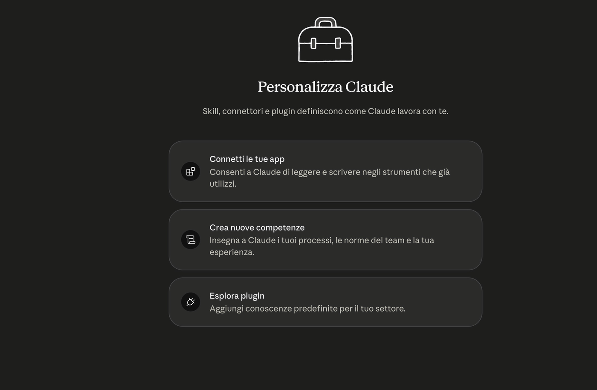
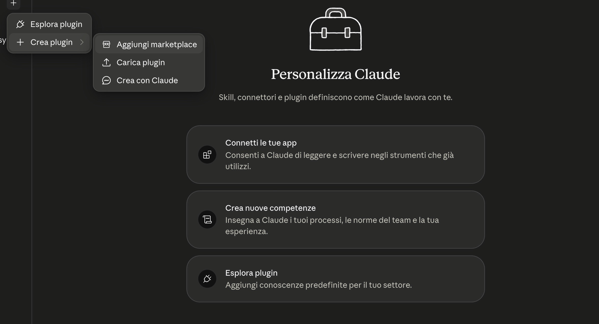
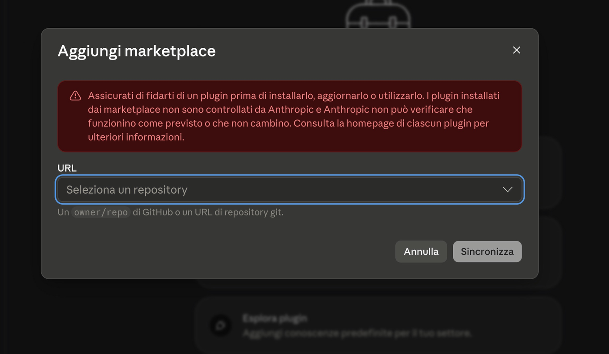

# Installazione del Kit Civilista Italiano — guida passo passo

*Tempo richiesto: dieci minuti. Non serve alcuna competenza tecnica: si clicca, non si scrive codice.*

Tre passi: il **plugin** (le competenze), la **cartella di lavoro** (i tuoi fascicoli e la Knowledge Base), la **banca dati** (la giurisprudenza che si aggiorna da sola ogni settimana).

Le schermate dei primi passaggi sono qui sotto. Dove manca l'immagine, il testo descrive esattamente dove si trova ogni comando.

---

## Passo 1 — Il plugin

### 1.1 Apri Personalizza

Apri l'app Claude sul computer. In basso a sinistra, nella barra laterale, c'è la voce **Personalizza** (icona a forma di cursore/bacchetta). Cliccala: si apre la schermata "Personalizza Claude", con in alto le sezioni **Skills**, **Plugin**, **Connettori**.



### 1.2 Aggiungi il marketplace

In alto a destra nella schermata trovi un pulsante **+**. Cliccalo e scegli **Crea plugin**, poi **Aggiungi marketplace**.



Si apre una finestra con un solo campo di testo, intitolata "Aggiungi marketplace".



Incolla esattamente questa riga:

```
Synthos-Logic/civilista-italia
```

Non è un indirizzo web completo: è il nome del repository, con il trattino. Clicca **Sincronizza**.

Se compare l'errore *"Questo repository non è un marketplace"*, quasi sempre è un refuso: ricontrolla il trattino e le due parole.

### 1.3 Installa il plugin

Dopo la sincronizzazione si apre la **Directory**: in alto scegli **Plugin**, poi la scheda **Personale**. Vedrai una scheda intitolata **Civilista Italia**, di Synthos Logic, con la descrizione del kit.

Clicca il **+** sulla scheda. Dopo qualche secondo compare la conferma: *"Civilista italia è installato e pronto all'uso"*.

Cliccando sulla scheda vedi il dettaglio: versione, autore e l'elenco delle competenze installate. La versione mostrata dovrebbe coincidere con l'ultima pubblicata alla pagina delle release del progetto.

### 1.4 Attiva gli aggiornamenti automatici (consigliato)

Sempre in **Plugin → Personale**, accanto al nome `civilista-italia` ci sono **tre puntini (···)**. Cliccali e attiva **"Sincronizza automaticamente"**: da quel momento le nuove versioni arrivano da sole.

Se compare una richiesta di autorizzazione GitHub ("Concedi"), serve un account GitHub gratuito. Non è obbligatorio: dallo stesso menu dei tre puntini puoi usare **"Verifica aggiornamenti"** quando vuoi.

### 1.5 Verifica

Apri una **conversazione nuova** e scrivi:

```
/civilista-italia:versione
```

Deve rispondere con la versione del kit e l'elenco delle skill. Se non risponde, chiudi e riapri l'app: gli aggiornamenti valgono per le conversazioni nuove.

---

## Passo 2 — La cartella di lavoro

Il plugin è il motore; la cartella è l'archivio dove il kit conserva i tuoi fascicoli, lo scadenziario, i dati del tuo studio e la Knowledge Base. Servono entrambi.

### 2.1 Scarica il kit

Vai su `github.com/Synthos-Logic/civilista-italia`, clicca il pulsante verde **Code** e poi **Download ZIP**.

### 2.2 Decomprimi e rinomina

Decomprimi lo ZIP (doppio clic). Rinomina la cartella ottenuta in **`Civile-Italia`** e mettila dove preferisci — per esempio in Documenti. Evita percorsi dentro cartelle sincronizzate con servizi cloud che rinominano i file.

### 2.3 Collegala a Cowork

Nell'app Claude apri **Cowork**, poi **Seleziona cartella** (o "Aggiungi cartella") e scegli `Civile-Italia`.

### 2.4 Compila i dati dello studio

Apri il file `CLAUDE.md` dentro la cartella, con un qualsiasi editor di testo. In cima trovi un riquadro con i campi da compilare: avvocato, foro, numero di iscrizione, tribunale di riferimento, se sei cassazionista. Salva.

Sono i dati che il kit userà nelle intestazioni degli atti. Se preferisci non toccare i file, salta questo passo: al primo avvio il kit te li chiede a voce e li scrive lui.

---

## Passo 3 — La banca dati della giurisprudenza

Il kit nasce già con **10.080 massime civili** indicizzate: le Rassegne annuali delle Sezioni Civili 2023 e 2024 e le Rassegne mensili fino a febbraio 2026. Sono nella cartella che hai appena scaricato: non devi fare nulla per averle.

C'è però un secondo binario, che si aggiorna da solo: le **pronunce civili segnalate** settimanalmente dall'Ufficio del Massimario e i **rinvii pregiudiziali** ex art. 363-bis. Vivono in un archivio pubblico separato, aggiornato ogni lunedì da una procedura automatica.

Per scaricarlo la prima volta, apri una conversazione Cowork con la cartella `Civile-Italia` selezionata e scrivi:

```
Aggiorna la banca dati della giurisprudenza
```

Il kit esegue la sincronizzazione e ti dice quante schede ha scaricato. La prima volta richiede qualche minuto (scarica anche l'archivio della Corte costituzionale, per default gli ultimi dieci anni); le volte successive scarica solo le differenze, ed è questione di secondi.

**Non serve alcun account GitHub**: l'archivio è pubblico.

Ripeti lo stesso comando quando vuoi essere sicuro di avere le ultime pronunce — indicativamente una volta a settimana. Il kit ti avvisa da solo quando la banca dati locale ha più di sette giorni.

---

## Il primo avvio

Nella conversazione Cowork con la cartella selezionata, scrivi:

```
Iniziamo
```

Il kit si presenta, raccoglie i dati dello studio se mancano e apre con te il **primo fascicolo su un caso vero**: parti, valore, materia, rito, stato della condizione di procedibilità, prossima udienza. In un quarto d'ora hai un fascicolo funzionante, non una demo.

Da lì in avanti si lavora a voce: *"calcola il termine per costituirmi"*, *"cerca giurisprudenza sulla compensazione volontaria"*, *"prepara la comparsa di risposta"*, *"verifica l'atto prima del deposito"*.

---

## Aggiornare il kit

Quando esce una nuova versione:

1. **Personalizza → Plugin → Personale**;
2. accanto al nome `civilista-italia` clicca i **tre puntini (···)** e scegli **"Verifica aggiornamenti"**. Il "Commit sincronizzato" indicato nel menu deve cambiare: è il segno che il catalogo si è allineato;
3. riavvia l'app, apri una **conversazione nuova** e scrivi `/civilista-italia:versione`.

### Se il kit resta fermo (dice "aggiornato" ma non lo è)

È un problema noto dell'app: la sincronizzazione del catalogo può bloccarsi in silenzio e continuare a dire "aggiornato" restando a una versione vecchia. Lo sblocco è sicuro e **non tocca i tuoi fascicoli né la Knowledge Base**, perché rimuove solo il catalogo:

1. **Personalizza → Plugin → Personale**;
2. sul chip `civilista-italia` clicca **···** → **Rimuovi**;
3. clicca **+** → **Aggiungi marketplace** → incolla `Synthos-Logic/civilista-italia` → **Sincronizza**;
4. reinstalla il plugin con il **+** sulla scheda;
5. riavvia l'app, conversazione nuova, `/civilista-italia:versione`.

---

## Problemi comuni

**"Questo repository non è un marketplace"** — Controlla di aver scritto esattamente `Synthos-Logic/civilista-italia`.

**Il kit non trova i miei fascicoli** — Verifica che in Cowork sia selezionata la cartella `Civile-Italia` e non una cartella superiore.

**Ho installato un aggiornamento ma non lo vedo** — Gli aggiornamenti valgono per le conversazioni nuove: chiudi quella aperta e aprine un'altra.

**Il pulsante "Aggiorna" sulla scheda del plugin è grigio** — Normale: prima va sincronizzato il catalogo, con i tre puntini accanto al nome del marketplace → "Verifica aggiornamenti".

**Ho anche il Kit Penalista installato** — Nessun problema: i due kit convivono, hanno prefissi diversi (`penalista-` e `civilista-`) e cartelle di lavoro separate. Tienile distinte: un fascicolo penale nella cartella penale, uno civile in quella civile.

---

## Che cosa hai installato

- Il **plugin** porta le competenze: avvio guidato, analisi del caso, calcolo dei termini (anche quelli a ritroso), redazione degli atti, condizioni di procedibilità, quantificazione del danno e delle spese, ricerca giurisprudenziale, verifica prima del deposito, archiviazione di nuove fonti.
- La **cartella** conserva il lavoro: fascicoli, scadenziario, dati dello studio, Knowledge Base.
- La **banca dati** tiene aggiornata la giurisprudenza senza che tu debba cercarla.

Una regola su tutte, che vale la pena conoscere prima di iniziare: **il kit non cita una sentenza che non può mostrarti**. Se una massima non è nella Knowledge Base, lo dice — invece di ricostruirla a memoria. Le citazioni che produce sono verificabili: numero, fonte, pagina, e il link al documento ufficiale.
